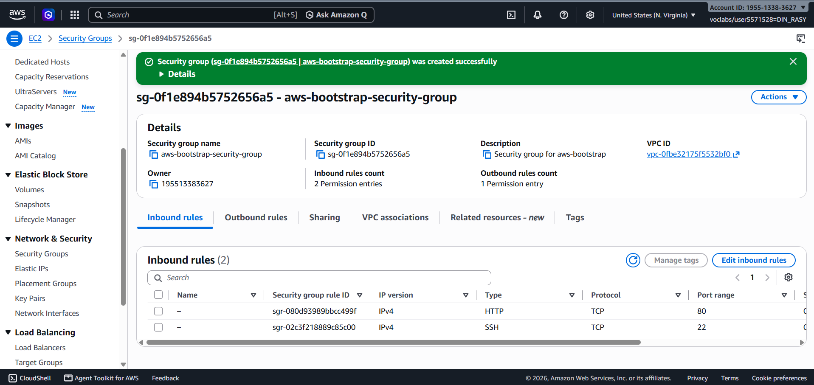
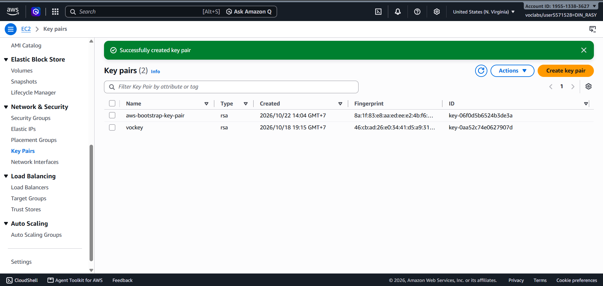
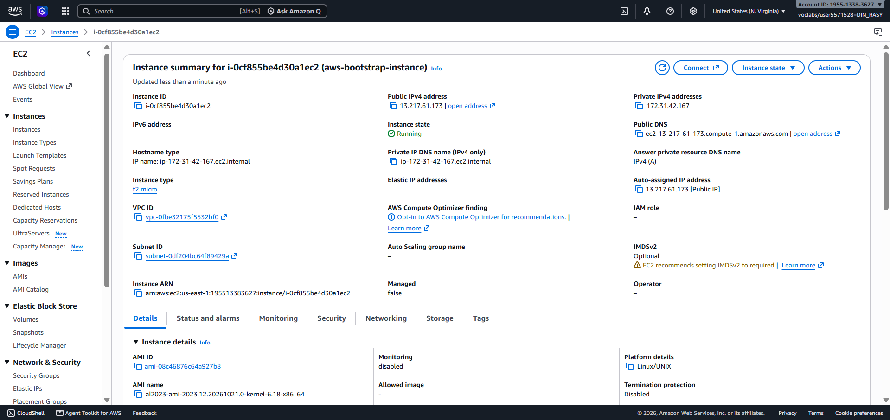
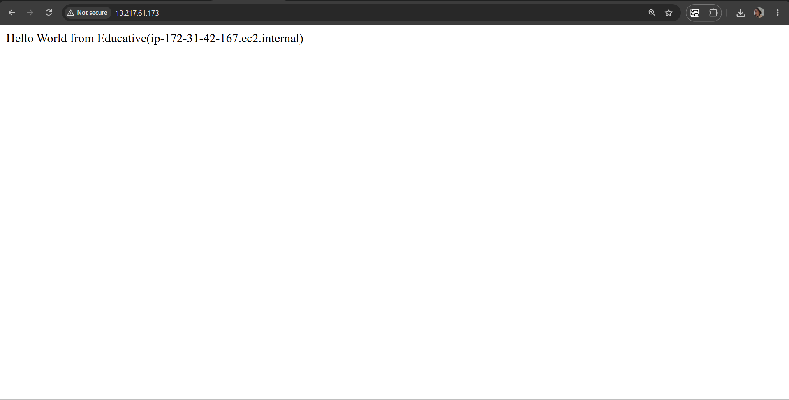
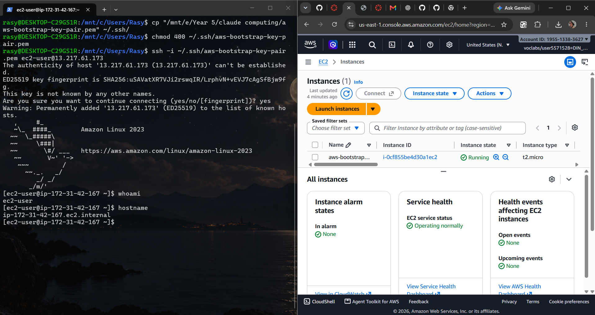
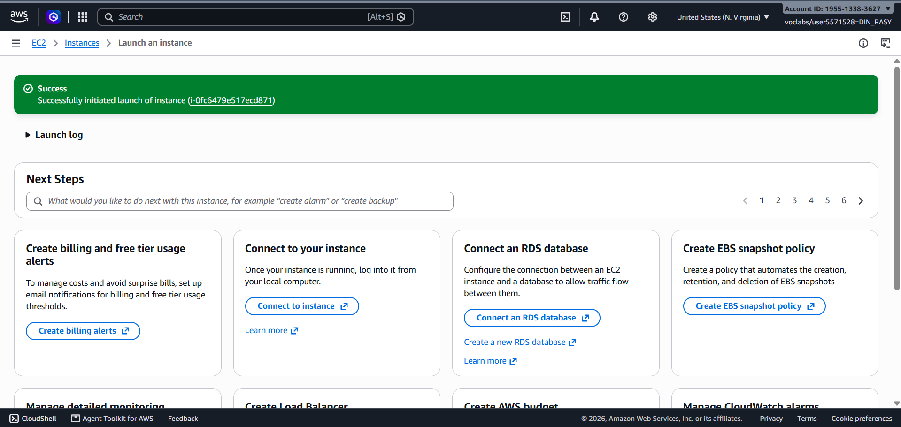
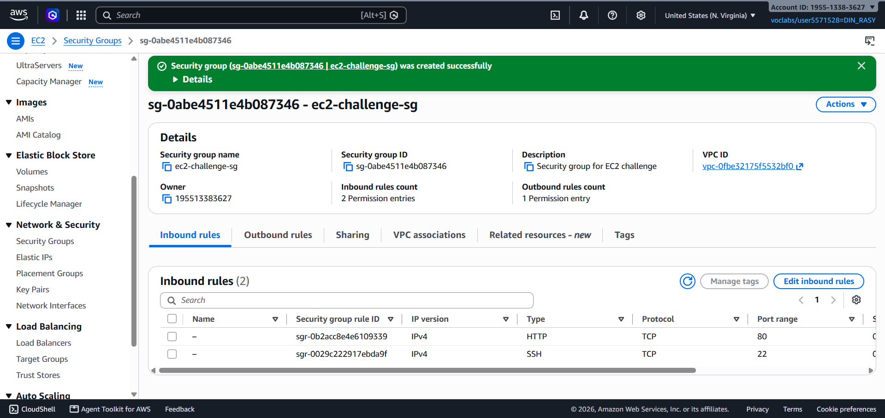
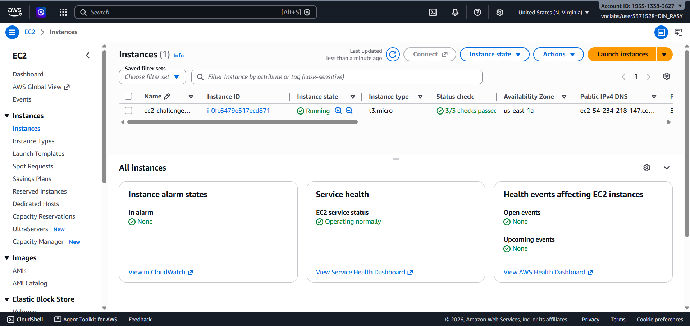
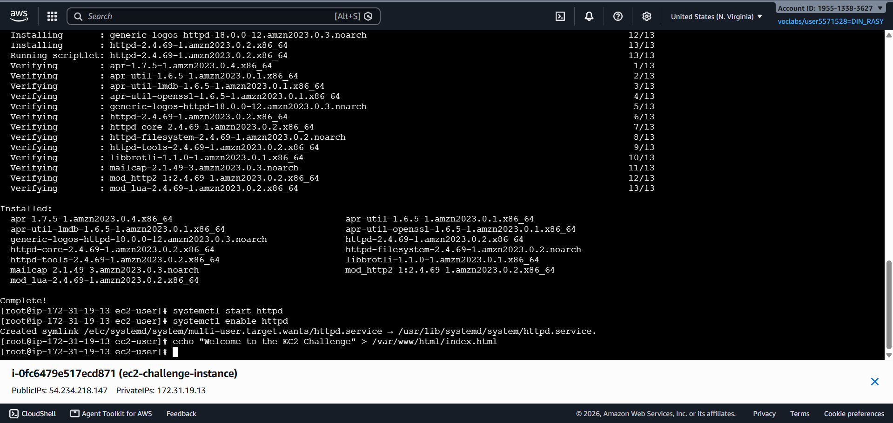
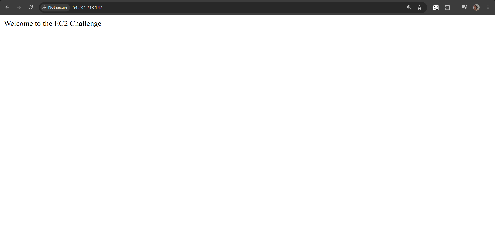

# Cloud Lab 1 Submission — Amazon EC2

Copy this template to `cc-lab-YOUR_ID/lab1/README.md` in your own repository. Follow [the instructions](lab1-instruction.md). Put your screenshots in `lab1/images/` with the file names below.

- **Student name:** **Din Rasy**
- **Student ID:** **e20221071**
- **Learner Lab user name:** **voclabs/user5571528=DIN_RASY**
- **Date completed:** **10/22/2026**

---

## Part 1.1 — An Amazon EC2 Walkthrough

### Security group



### Key pair



### Instance details



### Browser test



### SSH connection



Did you connect with your own SSH client or with EC2 Instance Connect?

---

## Part 1.2 — EC2 Web Solution (Challenge)

### Launch configuration



### Security group



### Running instance



### Commands on the instance



Paste the commands you ran to install the web server and create `index.html`:

```bash

```

### Browser test



---

## Questions

1. Your security group has an SSH rule and an HTTP rule. What does each one let you do? What would stop working if you deleted the HTTP rule?

   **Answer:** The SSH rule allows secure remote terminal access to manage and configure the instance over port 22. The HTTP rule allows users to access the website over port 80. If the HTTP rule were deleted, users could no longer load the web page through the security group.

2. In Part 1.1 you never logged in to install the web server. What installed it, and when did it run?

   **Answer:** A User Data script in the instance launch configuration installed the web server. It ran automatically the first time the instance booted.

3. Why does the web page open with `http://` but not with `https://`?

   **Answer:** The web server is configured for unencrypted HTTP on port 80. HTTPS requires SSL/TLS configuration, including a certificate, which was not set up.

4. Part 1.2 asked for a 10 GiB root volume. Where in the launch settings did you set it, and how can you check the size on the running instance?

   **Answer:** The root volume size was set to 10 GiB in the launch settings under **Configure storage**. On the running instance, `lsblk` or `df -h` can be used to check the volume size.

## Problems and how I solved them (optional)

I had a permission error when trying to SSH into the instance with the `.pem` key. I moved the key into WSL and set its permissions with `chmod 400`.

## AI note (optional)

An AI assistant suggested the terminal commands to install and start the Apache web server. I checked the suggestion by loading the challenge HTML page successfully in a browser.

## Clean up

- [X] Part 1.1: instance terminated, key pair and security group deleted.
- [X] Part 1.2: instance terminated, security group (and key pair, if any) deleted.